# Arsh's Glass TV

**A fast, Apple TV–style home screen for Android TV, with an AI remote built in.**

Arsh TV replaces the stock launcher with a Top Shelf, glass panels, folders, an app switcher, aerial screensavers and more, all built with plain Android Views so it stays smooth on slow 2 GB TVs. It also turns the TV into an [MCP](https://modelcontextprotocol.io) server, so Claude, ChatGPT or any MCP client can find a show and put it on, pause, change the volume, or turn the TV off.

https://github.com/user-attachments/assets/7bb29dd3-717f-41ce-a5cb-c11ba973559d

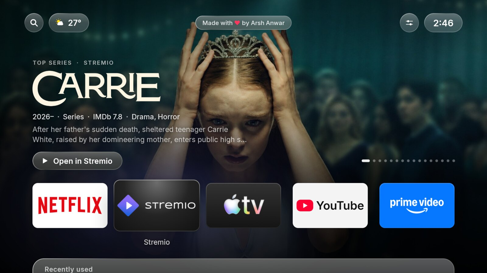

| | |
|---|---|
| 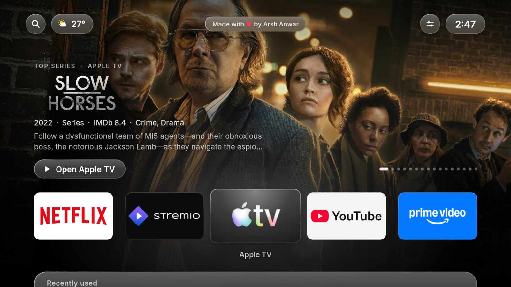 | 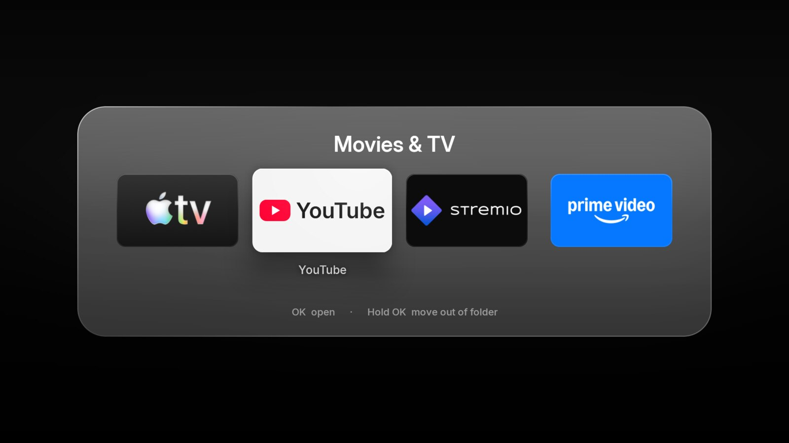 |
| **Top Shelf per app.** Focus any streaming app and the shelf shows what's popular on it. | **Folders.** Frosted-glass tiles that open as a sheet. |
| 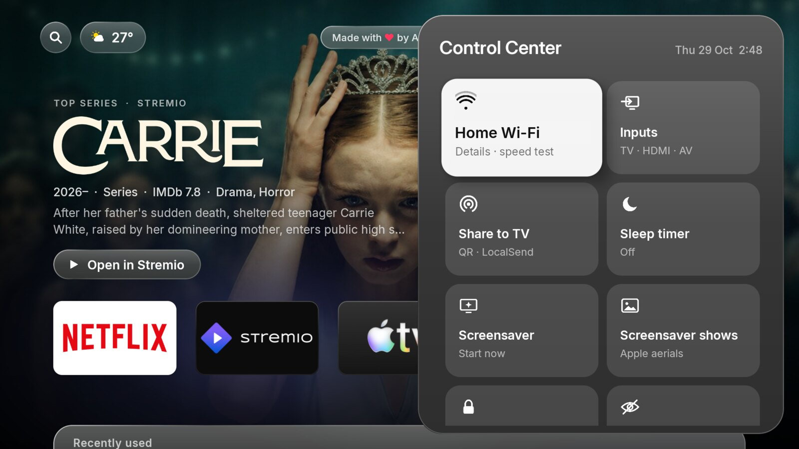 | 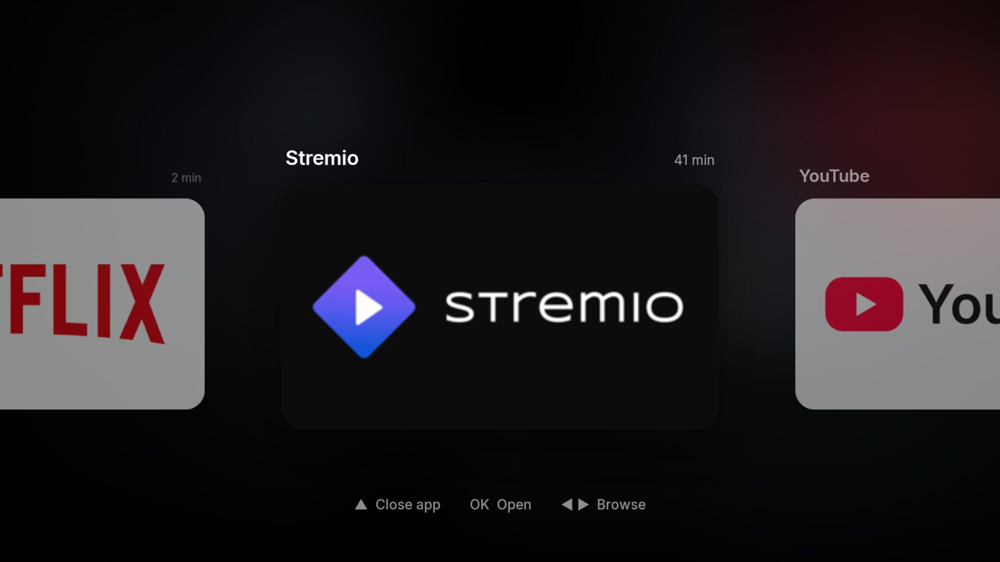 |
| **Control Center.** Press Home on the top row. | **App switcher.** Press Home twice; ▲ closes an app. |
| 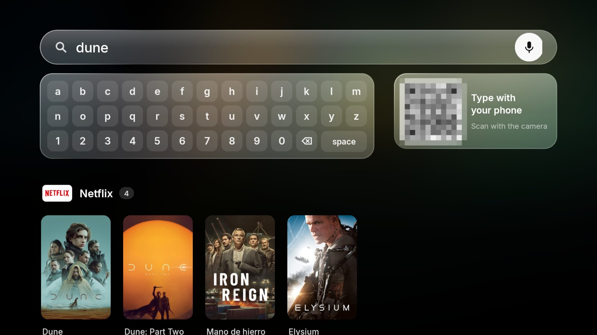 | 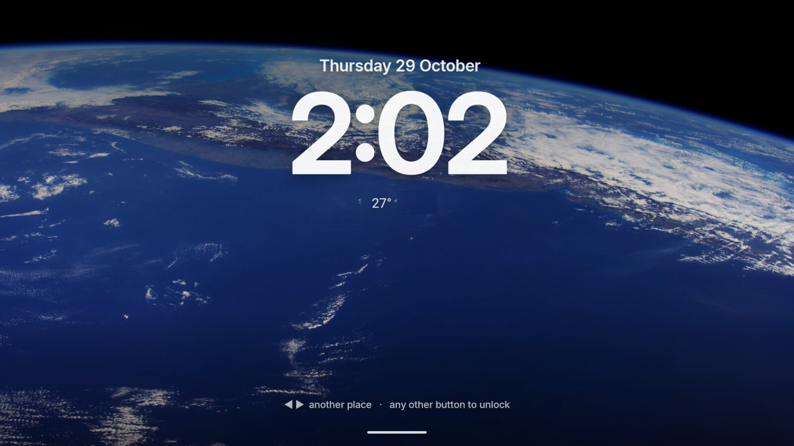 |
| **Search.** Your apps, plus where any title is streaming. | **Aerial screensaver.** Apple's aerials, matched to the time of day. |
| 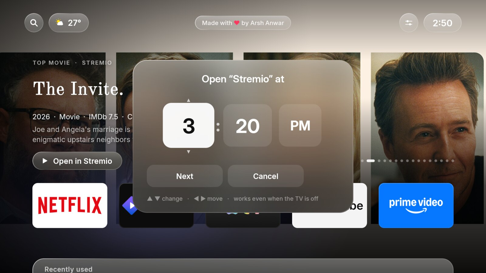 | 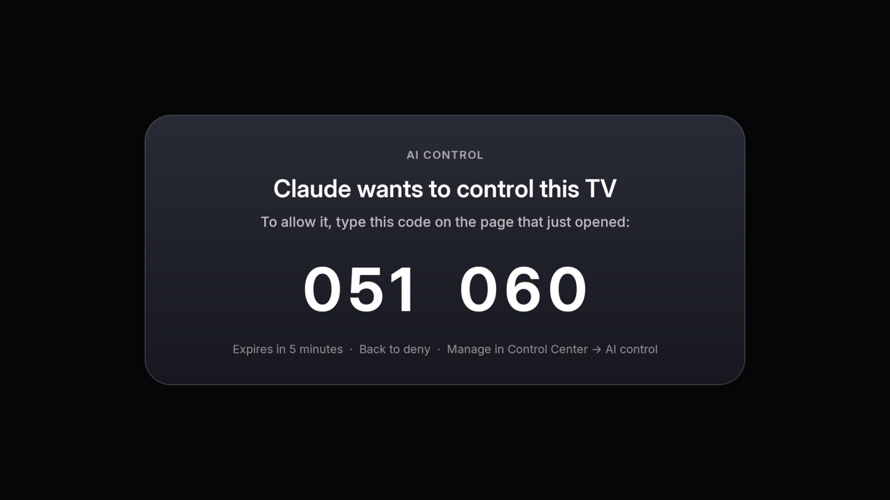 |
| **Routines.** Open a show at a set time, even from standby. | **AI control.** AI apps connect with a code shown on the TV. |

## Features

**Home**
- **Top Shelf:** full-screen artwork with title logos, ratings and genres. Each streaming app gets its own shelf (Netflix, Prime Video, Disney+, Max, Stremio, YouTube trailers: any app JustWatch knows about in your country). OK opens the title itself, not just the app.
- **Favourites row** that scrolls sideways, an **app grid** you can rearrange (tiles wiggle while moving), and **folders**.
- **tvOS details:** focus tilt and parallax glare, a tile that grows into the app when it opens, edge bounce, UI sounds, a glow in the focused app's colour, and a "Recently used" shelf.
- **App switcher** (Home twice) and **Control Center** (Home on the top row): Wi-Fi details and speed test, inputs, sharing, sleep timer, screensaver, hidden apps, AI control, routines.
- **Search** with an on-screen keyboard, voice, or **typing from your phone** (scan a QR). Results show which of *your* installed apps stream each title.

**Around the TV**
- **Aerial screensaver:** Apple's public tvOS aerials (streamed, not bundled). City flights by day; night, space and underwater after dark. ◀ ▶ skips to another place. It can also show movie artwork or your own photos.
- **Routines:** "open The Office on Netflix every weekday at 9 PM". The TV switches itself on from standby and counts down 10 seconds (Back cancels).
- **Sharing:** send files from a phone with **Drop** (scan a QR, no app needed) or **LocalSend**. Received photos, videos and APKs open in the built-in Files panel.
- **Notification banners** in tvOS style, shown even over other apps (sleep timer warnings, ADB switching off, AI connections).
- **App lock and hiding** behind a 4-digit PIN, a native **sleep timer**, and a **Now Playing** card for music playing in the background.
- **`living-room-tv.local`:** the TV announces itself over mDNS, so `http://living-room-tv.local:53318` opens Drop without needing its IP.

**AI control (MCP)**: see [below](#ai-control-mcp).

**Performance:** no Compose, no animation libraries, no polling. Cards are cached as GPU layers, the frame ticker parks itself when nothing moves, background work runs at background priority, and the screensaver's clock overlay redraws once a minute. The launcher itself uses about 9 MB of RAM.

## Requirements

- An Android TV running **Android 8.0+** (developed on a Xiaomi Mi TV with Android 10 and 2 GB RAM).
- **ADB over the network** enabled on the TV (Developer options → Network debugging / ADB).
- To build: **JDK 21** and the **Android SDK**. The Gradle wrapper is included.

## Install

```sh
cd launcher
./install.sh 192.168.1.50        # your TV's IP (or: TV_IP=192.168.1.50 ./install.sh)
```

`install.sh` builds a release APK, installs it, and grants what the launcher needs over ADB. None of these can be requested from an app:

| Grant | Why |
|---|---|
| `DUMP` | Wi-Fi name (Android 10 hides it without location) and Now Playing (`dumpsys media_session`) |
| `READ_LOGS` | sees remote buttons that never reach apps (see [Remote buttons](#remote-buttons)) |
| `WRITE_SECURE_SETTINGS` | re-enables its accessibility service after a force-stop; switches ADB for AI control |
| `GET_USAGE_STATS` | Recently used apps and the app switcher |
| storage, `RECORD_AUDIO`, install packages | Files panel and received files, voice search, installing APKs you share |

It then sets Arsh TV as the home app and screensaver, enables its accessibility service (`KeyService`), and pre-compiles it for faster starts. Afterwards the TV keeps running Arsh TV even with ADB switched off.

## AI control (MCP)

The TV runs an MCP server (Streamable HTTP) on port `53318`.

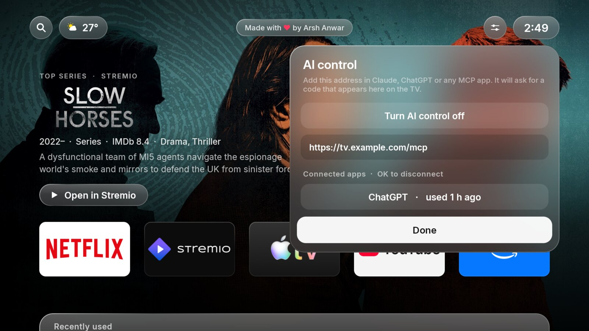

**Connect an AI app**
1. On the TV: **Control Center → AI control → Turn AI control on.** While it's off, every request is refused.
2. In the AI app, add the MCP server URL: `http://living-room-tv.local:53318/mcp` on your home network, or your public tunnel URL (see below).
3. The app opens a page asking for a code. **The TV shows a 6-digit code.** Type it in, and the app is connected.

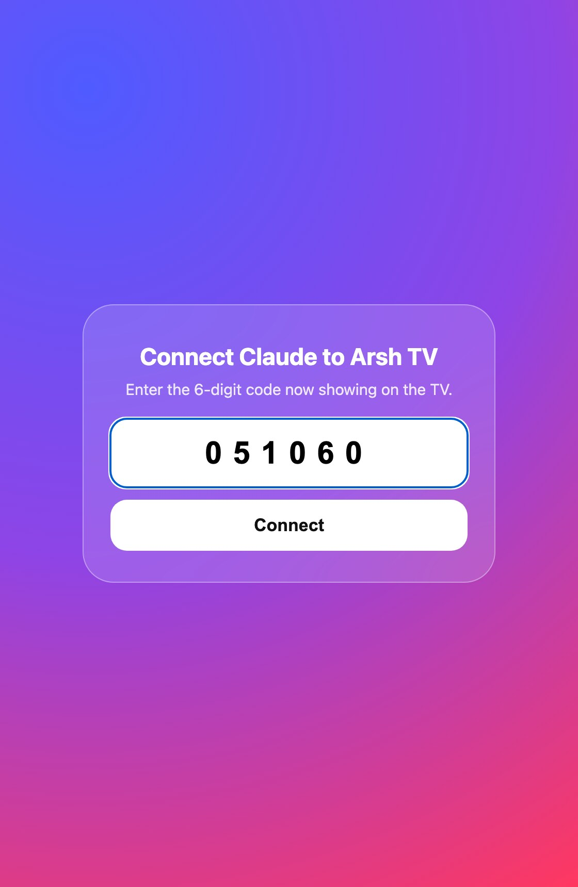

Connected apps are listed under **Control Center → AI control**. OK on one disconnects it immediately.

**Tools**

| Tool | What it does |
|---|---|
| `get_status` | screen on/off, app in front, what's playing, volume, sleep timer, time |
| `play_title` / `where_to_watch` | find which installed app streams a title and open it there |
| `open_app`, `list_apps`, `switch_input` | open apps, list them, switch to HDMI or TV |
| `media`, `volume`, `power`, `sleep_timer` | play/pause/seek, volume, on/off/screensaver, sleep timer |
| `read_screen`, `press`, `click`, `type_text` | read what's on screen and drive any app like a remote |
| `show_message` | banner on the TV ("dinner's ready") |
| `list_routines`, `add_routine`, `delete_routine` | scheduled shows |

`press` sends real remote keys through the TV's own ADB, which also works inside apps that ignore accessibility. ADB is switched on only while an AI is using the TV, and off again after 10 idle minutes. The first time, approve "Allow USB debugging" on the TV.

**Security model**
- OAuth 2.1 the way MCP clients expect it: protected-resource and server metadata (RFC 9728, RFC 8414), dynamic client registration (RFC 7591), authorization code with PKCE S256, and rotating refresh tokens.
- The "login" is physical presence: the code only appears on the TV screen. It expires after 5 minutes or 5 wrong tries.
- Tokens are stored hashed. Access tokens last 24 hours, refresh tokens 90 days.
- A forwarded host is only trusted from the tunnel relay's address range, so nobody on your Wi-Fi can make the TV display a look-alike URL.

**Reaching it from the internet** (claude.ai, ChatGPT and mobile apps need a public HTTPS URL)

Publish **only** the MCP and OAuth paths, never the whole port: the Drop page and the remote-ADB page must stay on your LAN. One way is [Tailscale Funnel](https://tailscale.com/kb/1223/funnel) on an always-on Linux machine in your tailnet. In testing, Funnel's built-in proxy could not dial an Android TV peer directly, so it goes through a tiny local relay:

```sh
# on the always-on Linux box (TV_TS_IP = the TV's Tailscale address)
socat TCP-LISTEN:53319,bind=127.0.0.1,fork,reuseaddr TCP:$TV_TS_IP:53318 &   # run it as a systemd service
for p in /mcp /oauth /.well-known/oauth-protected-resource /.well-known/oauth-authorization-server /.well-known/openid-configuration; do
  tailscale funnel --bg --set-path $p http://127.0.0.1:53319$p
done
```

Then use `https://<machine>.<tailnet>.ts.net/mcp` as the server URL. Cloudflare Tunnel or any reverse proxy works the same way, as long as only those paths are routed.

## Remote buttons

Many TVs never deliver the remote's Home button to third-party launchers. On the Xiaomi this was built on, Home arrives as `KEYCODE_ALL_APPS` (consumed by the system), and the PatchWall button is a "global key" sent straight to a Xiaomi service. `KeyService` (an accessibility service) watches the system log (`READ_LOGS`) for those presses and brings Arsh TV to the front. Two Home presses in quick succession open the app switcher. On other TVs, adjust the patterns in `KeyService.watchLog()`.

## Debloat scripts (optional, Xiaomi)

`debloat/` contains the package lists used to slim down a Xiaomi Mi TV, in four tiers from safe to aggressive. They remove apps for the current user only (`pm uninstall -k --user 0`), which is fully reversible:

```sh
TV_IP=192.168.1.50 debloat/debloat.sh tier1            # dry run: lists what would go
TV_IP=192.168.1.50 debloat/debloat.sh tier1 --apply
TV_IP=192.168.1.50 debloat/restore.sh <package>        # bring one back
```

> ⚠️ Read the lists before applying anything. Firmware differs between models. On some Xiaomi firmware, `android.settings.PRIVACY_SETTINGS` opens the **factory reset** screen, so never fire settings intents you haven't checked.

## Project layout

```
launcher/                 Android app (Kotlin, plain Views)
  app/src/main/java/com/arshanwar/tv_launcher/
    MainActivity.kt       home screen, Top Shelf, grid, folders, Control Center, search, switcher
    Hero.kt  Ui.kt        glass rendering, fonts, curves, sounds
    Shelf.kt              Top Shelf content (Cinemeta, JustWatch), weather
    LockView.kt           screensaver: aerials, artwork, photos
    Share.kt              HTTP server: Drop, LocalSend, mDNS, remote ADB page, MCP routing
    TvMcp.kt  McpAuth.kt  MCP tools and their OAuth
    Routines.kt  Banner.kt  NowPlaying.kt  KeyService.kt  AppLock.kt  ...
  install.sh              build, install and grant
debloat/                  optional Xiaomi package lists and scripts
docs/screenshots/
```

## Known limitations

- **Netflix and some other apps draw their own UI,** so `read_screen` and `click` can't see inside them. `play_title`, `media` and `press` still work.
- **No AI screenshots:** Android 10 can't take them silently, so assistants "see" through on-screen text only.
- **Deep sleep:** some TVs drop Wi-Fi after hours in standby. Until something wakes them (Wake-on-WLAN from another device), they're unreachable.
- **Unofficial data sources:** Top Shelf and "where to watch" use public, unofficial endpoints (JustWatch, Cinemeta) and can change without notice. The streaming region is detected from your IP address, falling back to the TV's locale (`Region` in `Shelf.kt`).

## Credits

[Inter](https://rsms.me/inter/) (SIL OFL, bundled) · [dadb](https://github.com/mobile-dev-inc/dadb) · [ZXing](https://github.com/zxing/zxing) · [Open-Meteo](https://open-meteo.com) · [ipwho.is](https://ipwho.is) · JustWatch · Cinemeta / Stremio · metahub · Apple's tvOS aerial videos (streamed from Apple's servers, not redistributed) · the [LocalSend](https://localsend.org) protocol.

Netflix, YouTube, Prime Video, Apple TV and other names are trademarks of their owners. This project isn't affiliated with any of them.

## License

[MIT](LICENSE)
